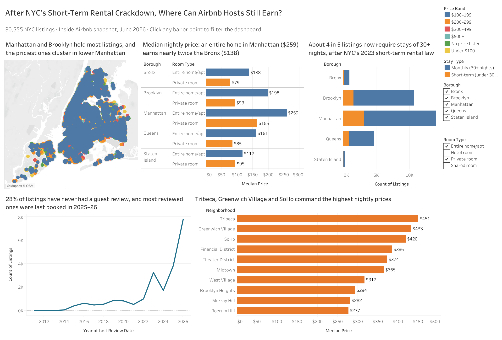

# NYC Airbnb Market Analysis

## Overview

I built this Tableau dashboard to explore Airbnb listings across New York City's five boroughs using an Inside Airbnb snapshot from June 2026.

I wanted to understand how listing prices, minimum-stay requirements, and guest-review activity differ across the city.
## Dashboard Preview

## Key Findings

* **30,555 unique listings** were included in the dataset.
* **80.9% of listings** require a minimum stay of 30 nights or more.
* **28.2% of listings** have never received a recorded guest review.
* The median nightly price for entire-home listings with available prices was **$259 in Manhattan** and **$138 in the Bronx**.
* Tribeca, Greenwich Village, and SoHo ranked among the highest-priced neighborhoods among areas with at least 25 listings with recorded prices.

## Dashboard

Explore the interactive dashboard on Tableau Public:

[View the NYC Airbnb Dashboard](https://public.tableau.com/app/profile/tariro.kureva/viz/NYCAirbnbDashboard-TariroKureva/NYCAirbnbDashboard?publish=yes)

## Tools Used

* Tableau
* Data visualization
* Exploratory data analysis
* Geographic and price comparisons

## Data Limitations

Approximately 29% of listings had no recorded price. Price comparisons therefore use listings with available prices.

Guest-review counts are cumulative, so a listing with no recorded reviews should not automatically be considered inactive.

This dataset represents a snapshot from June 2026. It shows patterns in the data but cannot, on its own, establish that a particular regulation caused those patterns.

## Author

**Tariro Kureva**
M.S. Applied AI & Business Analytics

[LinkedIn](https://www.linkedin.com/in/tariro-kureva/) | [GitHub](https://github.com/Tariro-Kureva)
